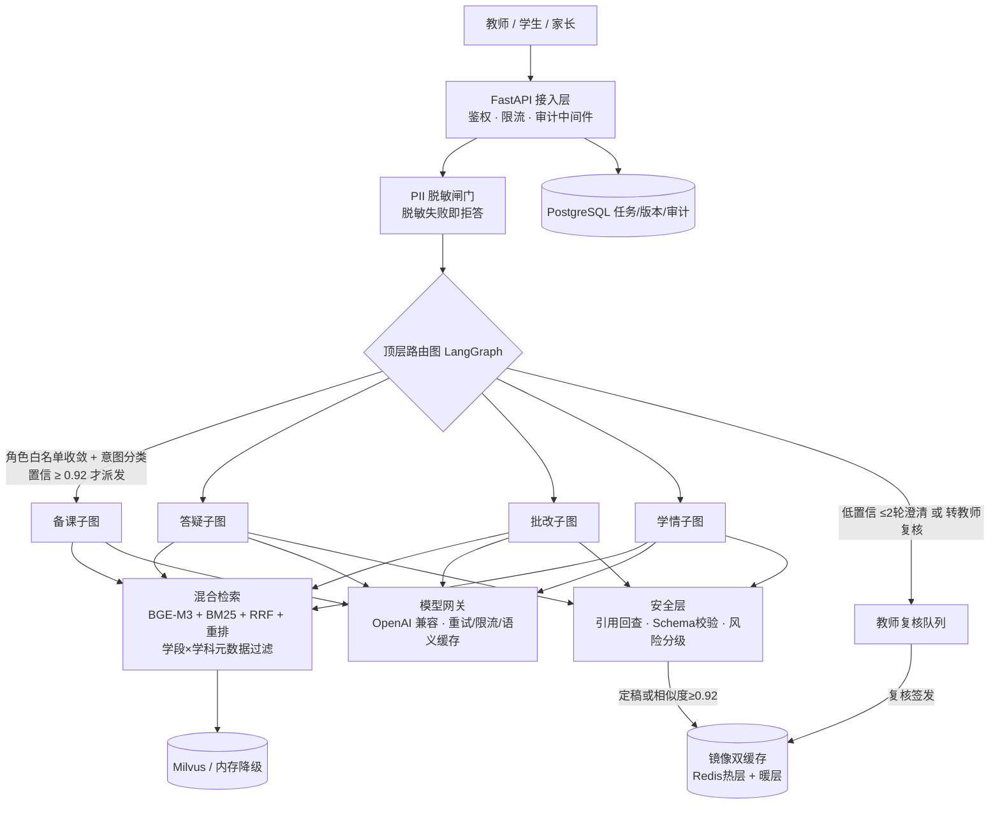
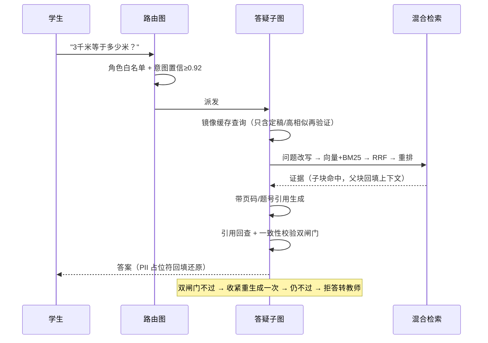

# 慧学 · 中小学多智能体教学辅助平台（smartedu-agent）

面向区域级中小学教育平台的**多智能体教学辅助系统**开源实现：以 LangGraph 顶层路由图统一调度
**备课 / 答疑 / 批改 / 学情** 四个子智能体，配套混合检索、未成年人数据脱敏、教师复核闭环与
全链路审计，全部核心逻辑可**无密钥离线跑通**（内置确定性 mock 降级）。

## 项目背景

某市建设区域中小学教育平台，覆盖教师、学生、家长三类角色，日常痛点集中在：

- 教师：备课信息分散（课标/教材/题库各一套系统），批改占用大量课后时间；
- 学生：课后提问找不到及时、可信的解答，网上通用大模型答案与本地教材口径不一致；
- 家长：想了解孩子薄弱点，但只能拿到笼统的分数，看不到知识点级画像；
- 管理者：AI 直接面向未成年人输出内容，缺乏审核、留痕与纠偏机制。

慧学的定位不是"聊天机器人"，而是**带审核纪律的教学辅助流水线**：机器产出、教师签发、
全程审计；置信不足宁可澄清或转人工，绝不硬答。

## 架构总览



### 答疑链路（其余子图同构）



## 功能特性

- **路由纪律**：先按角色收敛可用 Agent 白名单，再做意图分类；置信不足走两轮澄清、
  仍不明确自动打包转教师复核，杜绝"猜着路由"与越权调用；
- **检索可信**：BGE-M3 语义 + 自研中文 BM25 双路召回，RRF 融合后重排；
  父子块切分（子块保精度、父块保上下文）；学段×学科元数据过滤贯穿全链路；
- **答案可回查**：每个结论句强制携带【来源:文档ID | 页码 | 题号】，引用坐标与证据集逐一回查；
- **批改零幻觉**：客观题纯规则判分（全半角/标点归一化），主观题按评分要点逐项核分，
  低置信与学生申诉一律转教师；
- **学情可复现**：掌握度按知识树时间衰减加权计算，掉队预警完全由规则引擎触发，
  LLM 只解释成因、不制造标签；
- **未成年人合规**：NER+正则双引擎脱敏，占位符进模型、映射表仅存校内、会话结束即销毁，
  脱敏不可靠直接拒答；
- **离线可跑**：无密钥自动进入确定性 mock 模式（哈希 n-gram 嵌入、词面覆盖重排、
  注入式 mock 评分），单测/评测/演示全部离线可复现；
- **多源接入**：Markdown 直读，PaddleOCR / Whisper 以适配器封装为可选依赖；
- **压测就绪**：Locust 脚本模拟答疑高峰混合流量。

## 目录结构

```
smartedu-agent/
├── backend/
│   ├── app/
│   │   ├── main.py            # FastAPI 工厂 + SSE 流式端点
│   │   ├── config.py          # 配置与 mock 模式判定
│   │   ├── api/               # 五个路由 + 鉴权/限流/审计依赖
│   │   ├── graphs/            # 路由图 + 备课/答疑/批改/学情子图 + 共享状态
│   │   ├── retrieval/         # 嵌入/Milvus/BM25/混合检索/重排/切片
│   │   ├── tools/             # Function Calling 工具（知识库/题库/课标/教务）
│   │   ├── safety/            # 脱敏/Schema校验/引用回查/风险分级/敏感词
│   │   ├── memory/            # 最近N轮 + 滚动摘要
│   │   ├── data/              # 语料管道 + seed_corpus 示例语料
│   │   ├── db/                # SQLAlchemy 模型 + 镜像双缓存
│   │   └── gateway/           # OpenAI 兼容模型网关
│   └── prompts/               # 四个子 Agent 系统提示词（原创）
├── docs/                      # 架构 / 数据治理 / 评测设计
├── eval/                      # 评测集、评测与 badcase 归因脚本
├── scripts/                   # Milvus 初始化、语料入库
├── deploy/                    # Dockerfile / compose / locust
└── tests/                     # pytest（离线可跑）
```

## 快速开始

### 1. 环境准备（conda / pip 二选一）

```bash
# conda
conda create -n huixue python=3.10 -y && conda activate huixue
# 或 pip
python -m venv .venv && source .venv/bin/activate  # Windows: .venv\Scripts\activate

pip install -r requirements.txt
cp .env.example .env   # 全部占位符；不填密钥即以 mock 模式运行
```

### 2. 初始化知识库（离线 mock 嵌入，秒级完成）

```bash
python scripts/build_corpus.py                    # 灌入内置示例语料
python scripts/build_corpus.py --verify "3千米等于多少米"   # 抽样验证召回
python scripts/init_milvus.py                     # （可选）真实 Milvus 环境建 collection
```

### 3. 启动服务

```bash
uvicorn backend.app.main:app --host 0.0.0.0 --port 8000
```

或使用 Docker（api + Milvus + Redis + PostgreSQL 一键编排）：

```bash
docker compose -f deploy/docker-compose.yml up --build -d
```

### 4. curl 示例

```bash
# 健康检查（含 mock 模式与语料统计）
curl http://127.0.0.1:8000/healthz

# 答疑（学生角色，必须使用脱敏代号）
curl -X POST http://127.0.0.1:8000/api/v1/qa/ask \
  -H "X-Huixue-Key: dev-local-key" -H "X-User-Role: student" -H "X-User-Ref: S-demo01" \
  -H "Content-Type: application/json" \
  -d '{"question": "3千米等于多少米？", "grade": "小学三年级", "subject": "数学"}'

# 统一入口：走顶层路由图（角色收口 + 意图派发）
curl -X POST http://127.0.0.1:8000/api/v1/chat \
  -H "X-Huixue-Key: dev-local-key" -H "X-User-Role: teacher" \
  -H "Content-Type: application/json" \
  -d '{"utterance": "帮我批改作业打分", "result_input": {"items": [{"qid": "Q1", "type": "objective", "student_answer": "3000", "ref_answer": "3000", "full_score": 5}]}}'

# SSE 流式端点
curl -N "http://127.0.0.1:8000/api/v1/chat/stream?q=3千米等于多少米&session_id=d1" \
  -H "X-Huixue-Key: dev-local-key" -H "X-User-Role: student" -H "X-User-Ref: S-demo01"

# 教师复核队列
curl "http://127.0.0.1:8000/api/v1/admin/review-queue" \
  -H "X-Huixue-Key: dev-local-key" -H "X-User-Role: teacher"
```

### 5. 评测与测试

```bash
python -m pytest tests -q                 # 25 项单测，离线通过
python eval/run_eval.py                   # 30 条评测集
python eval/run_eval.py --out eval/results.jsonl && python eval/badcase_analysis.py eval/results.jsonl
locust -f deploy/locustfile.py --host http://127.0.0.1:8000   # 压测
```

## 评测指标（区域平台试运行口径）

| 指标 | 口径 | 结果 |
| --- | --- | --- |
| 答疑自助解决率 | 无需转教师即闭环的提问占比 | **80%** |
| 客观题判分准确率 | 规则判分与教师人工核对一致 | **99%+** |
| 主观题与教师评分一致率 | 分差 ≤ 满分 20% 视为一致 | **88%** |
| 薄弱知识点识别准确率 | 预警知识点与教师认定重合 | **90%** |
| 首 Token 延迟 | 流式端点 P90 | **< 1.5s** |
| 峰值并发 | 区域平台高峰压测 | **4000 并发通过** |

> 指标为平台试运行阶段统计口径；本仓库离线评测（mock 模式）验证的是**链路与纪律正确性**，
> 数值指标需在接入真实模型与语料后按 `docs/evaluation.md` 的影子对比流程重新度量。

## 合规说明（未成年人数据）

- **脱敏前置**：所有进入模型的文本先经 NER+正则双引擎脱敏，姓名/学号/证件/联系方式
  以占位符替代，生成后在校内回填还原；
- **不留存**：脱敏映射表仅存于校内会话存储，会话结束即销毁；任务表只存输入哈希不存原文；
- **不训练**：平台不将学生数据用于任何模型训练；模型网关对接私有化部署或关闭数据回传的接口；
- **拒答优先**：无法可靠脱敏的输入直接拒答转人工，而非"先答了再说"；
- **人审兜底**：学生可见内容必须通过引用/一致性/敏感词三项检查；成绩评语只有教师签发
  一条下发路径，系统层面不存在自动发布。

## License

Apache-2.0（示例语料与提示词均为项目原创编写，不含任何真实教材内容）。
